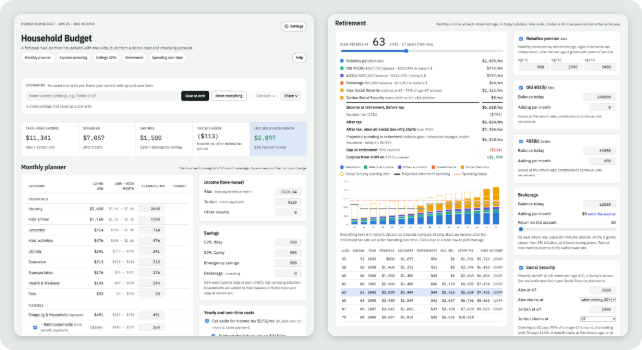
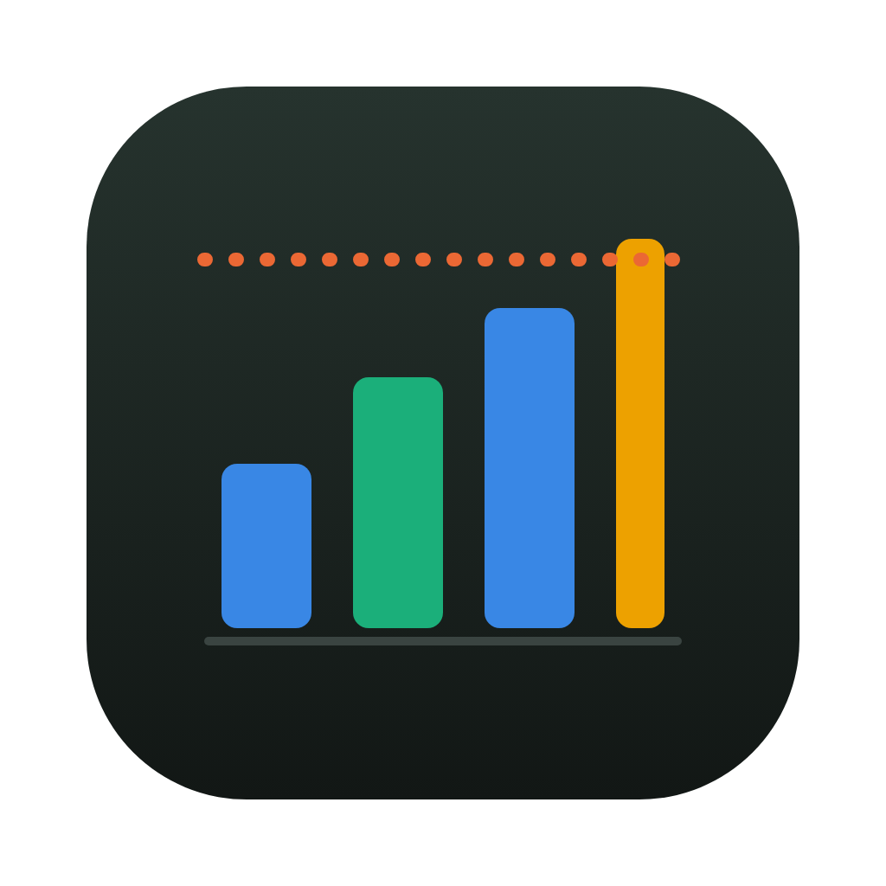

<sub>🤖 <b>Built with Claude.</b> This project was developed heavily with <a href="https://www.anthropic.com/claude">Claude</a> (Anthropic's AI assistant) using Claude Code.</sub>

# Financial Planner

A private, local household budget and long-term planner. Point it at the CSV exports from your bank
and credit cards, describe your household (in the app or in YAML), and explore your monthly budget,
college savings, retirement and how spending changes over time.

**Full documentation: [the wiki](https://github.com/brookisme/financial_planner/wiki).**

<p align="center"></p>

## Contents

- [Install the Mac app (no code)](#install-the-mac-app-no-code)
- [Features](#features)
- [Privacy first](#privacy-first)
- [Quick start (terminal)](#quick-start-terminal)
- [Your own plan](#your-own-plan)
- [Commands](#commands)
- [Development](#development)
- [License](#license)

## Install the Mac app (no code)



1. Download the app from the [Releases page](https://github.com/brookisme/financial_planner/releases):
   `FinancialPlanner-macos-arm64.zip` for Apple Silicon (M1 and later) or `-x86_64.zip` for Intel.
2. Unzip it and drag **Financial Planner** into **Applications**.
3. The first time, **right-click** the app › **Open** › **Open** (it isn't signed by Apple yet).
4. The first launch sets itself up (a few minutes, needs the internet), then asks how to start:
   a new plan, a plan someone shared with you, a folder you already have, or the demo.

The planner opens in your browser.

**The menu-bar icon** 
appears at the top right of your screen while the app runs. Click it for:

| Item | What it does |
|---|---|
| Open Financial Planner | Opens the planner in your browser |
| Change Plan Folder… / New Plan… | Switch to another plan, or start a new one |
| Show Plan Folder | Opens the plan folder in Finder (e.g. to add CSV files) |
| Open Plan File… / Save Plan as File… | Open a plan someone sent you / send yours |
| Check for Updates… | Checks for a newer version; installs it and restarts if you say yes |
| Uninstall… | Removes the app and its downloaded files (your plans are kept) |
| Quit Financial Planner | Stops it |

Closing the browser tab leaves it running in the menu bar; opening the app again reuses it.
**Quit** stops it.

**Sharing your plan** (e.g. with your partner): menu-bar icon › **Save Plan as File…** (or
Settings › Share plan) makes one `.zip` with your settings, CSV data and scenarios. They open it
with menu-bar icon › **Open Plan File…**, or choose "Open a plan someone shared with me" on their
first launch. The file holds your real transactions, so share it privately (AirDrop, Messages).
To send just a what-if, use **Share** in the Scenarios bar instead.

More: [Desktop App](https://github.com/brookisme/financial_planner/wiki/Desktop-App) on the wiki.

## Features

- **Monthly planner**: every category at its average; change any number and see what's left over.
- **Explore spending**: monthly charts, top merchants and every transaction.
- **College 529s**: a projection for each child against the cost of college.
- **Property**: homes, cars and rentals: value, loans and payoff, replacement and rent.
- **Amazon orders**: add Amazon's data export and every item gets its own category instead of one
  "Amazon" lump, checked against the bank's Amazon charges.
- **Retirement**: income at each retirement age from pensions, accounts, investments and Social Security.
- **Spending over time**: how costs change as children leave home and after retiring.
- **Scenarios**: save, compare and share what-ifs, or share the whole plan as one file.
- **Settings and categorizing in the app**: no YAML editing required (but it's there if you want it).

## Privacy first

Everything runs on your computer and nothing is uploaded. Your plan folder holds real financial
data: **keep it out of public repositories and off the internet**, and use generic names (Partner A,
Child 1). See [Privacy and Safety](https://github.com/brookisme/financial_planner/wiki/Privacy-and-Safety).

## Quick start (terminal)

For people comfortable with a terminal (any OS). With Python 3.11+, install from
[PyPI](https://pypi.org/project/financial-planner/) and open the demo:

```bash
pip install financial-planner                      # add [desktop] for the Mac menu-bar app
financial_plan init ~/FinancialPlan-Demo --demo
financial_plan start ~/FinancialPlan-Demo
```

Your browser opens at http://127.0.0.1:8765 with a fictional demo household.

Or from source with [pixi](https://pixi.sh) (for development):

```bash
git clone https://github.com/brookisme/financial_planner.git
cd financial_planner
pixi run demo
```

## Your own plan

```bash
financial_plan init ~/MyFinancialPlan    # create a plan folder (prefix with `pixi run` from source)
financial_plan start ~/MyFinancialPlan   # open it
```

Put your bank and card CSV exports in `~/MyFinancialPlan/data/`, then click the **gear (Settings)**
at the top right to add your household, connect the CSVs and categorize. On a Mac,
`pixi run financial_plan launcher` adds a **Financial Planner** app to Applications (menu-bar icon,
opens in the browser). A no-code download is described in the
[Desktop App](https://github.com/brookisme/financial_planner/wiki/Desktop-App) page.

Step-by-step guide: [Quick Start](https://github.com/brookisme/financial_planner/wiki/Quick-Start).
Want an AI assistant to set it up with you? See [LLM_SETUP.md](https://github.com/brookisme/financial_planner/blob/main/LLM_SETUP.md).

## Commands

| Command | What it does |
|---|---|
| `financial_plan init [dir] [--demo]` | Create a plan folder (blank, or a copy of the demo). |
| `financial_plan start [dir]` | Open the app. |
| `financial_plan validate [dir]` | Check the config and CSVs. |
| `financial_plan inspect-csv FILE` | Show a CSV's columns and a suggested source entry. |
| `financial_plan export [dir]` / `import FILE` | Share a whole plan (config + data) as one .zip. |
| `financial_plan categorize [dir] [--unmatched]` | Category averages; rows no rule caught. |
| `financial_plan amazon [dir]` | Check an Amazon data export against the bank's Amazon charges (or print the setup to add). |
| `financial_plan uninstall` | Remove the desktop app and its files (plans are kept). |
| `financial_plan launcher` | Mac: add Financial Planner.app to /Applications. Elsewhere: a desktop shortcut. |

Details: [Command Line](https://github.com/brookisme/financial_planner/wiki/Command-Line).

## Development

```bash
pixi run -e dev test-all     # Python + forecast-math tests
pixi run -e dev web-build    # rebuild the web app
```

See [Development](https://github.com/brookisme/financial_planner/wiki/Development).

## License

BSD 3-Clause. Not financial advice: projections are rough and depend on the assumptions you enter.
